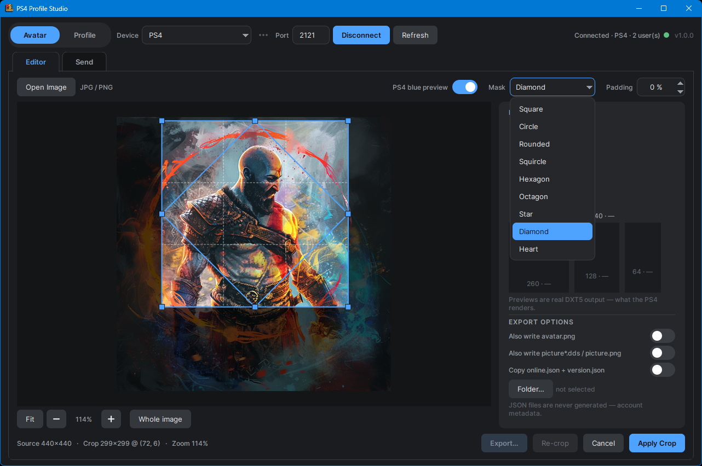
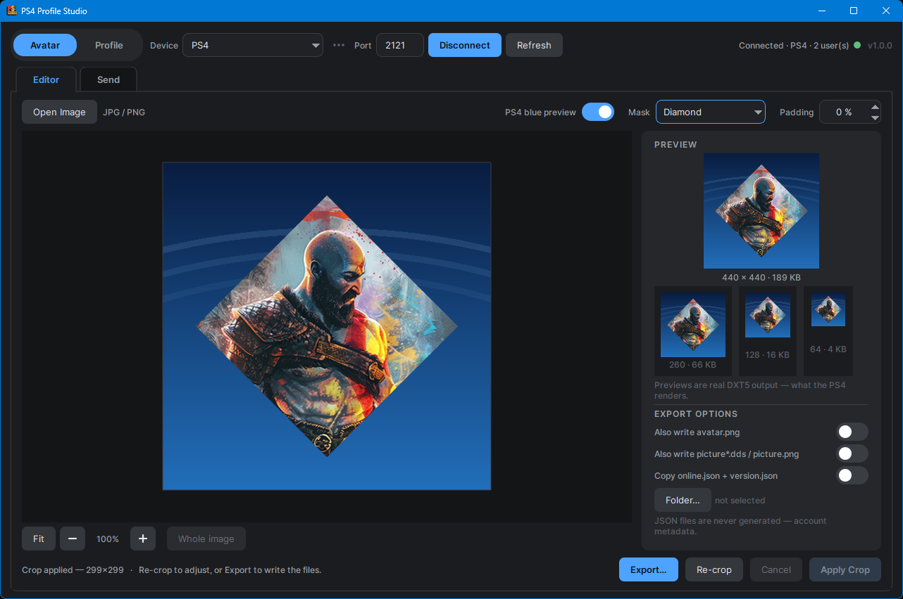
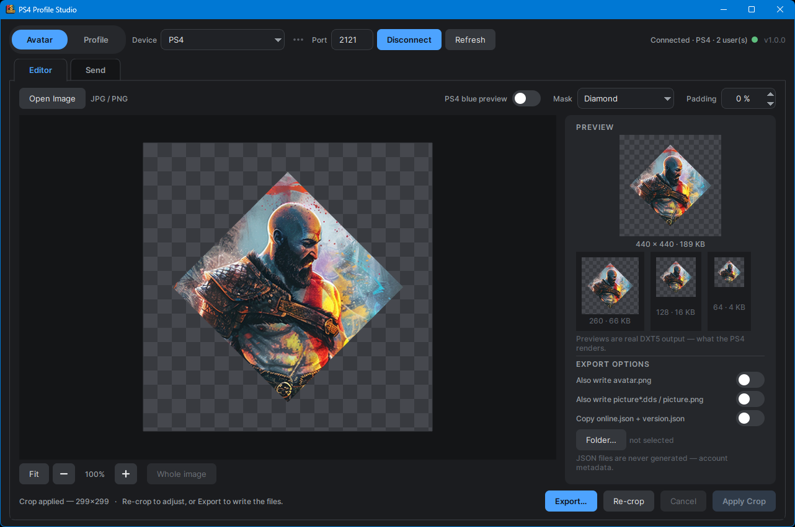
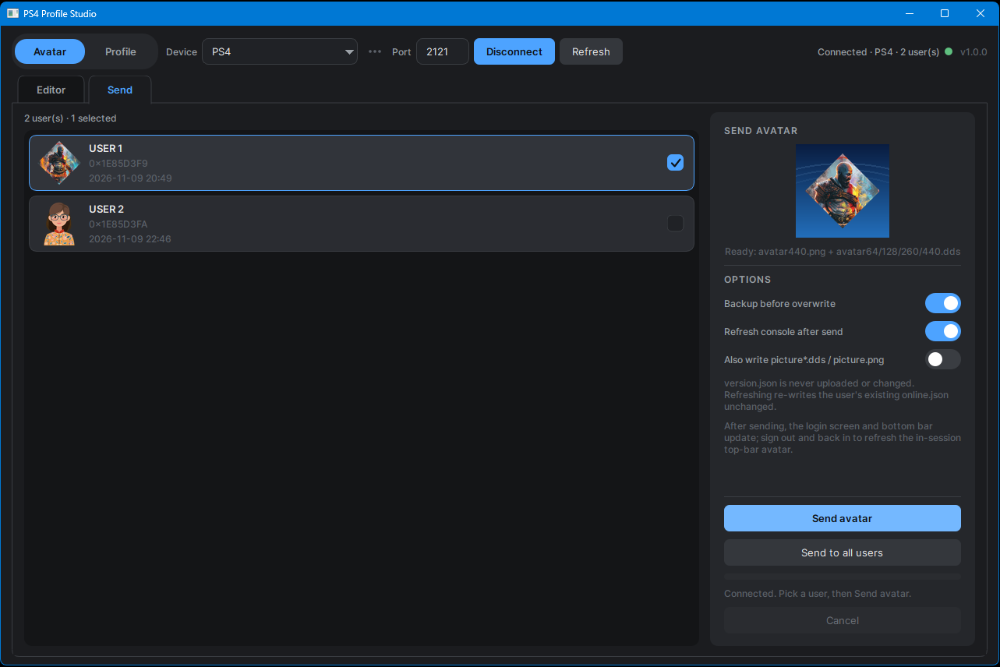
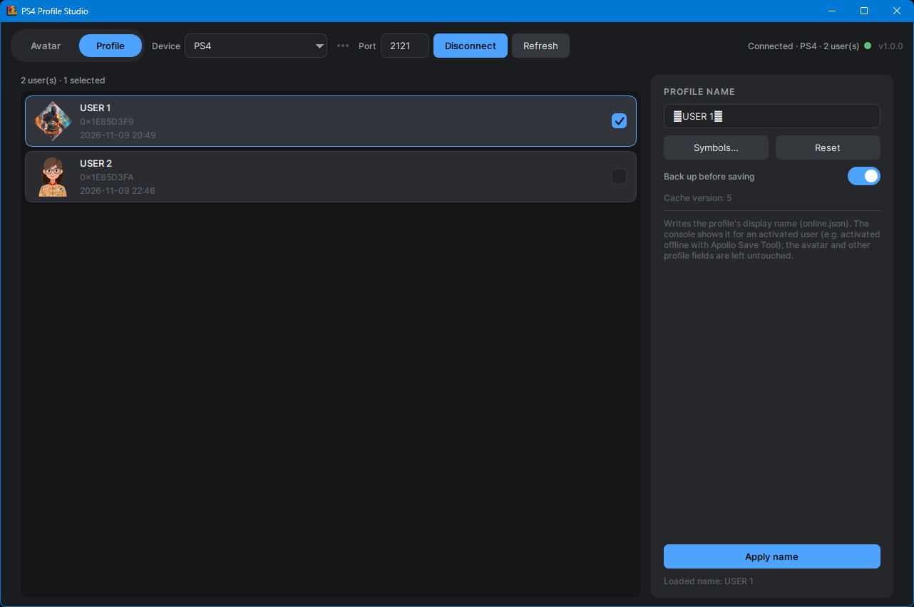
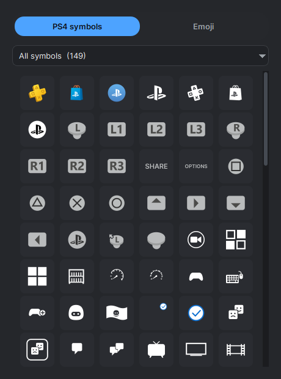
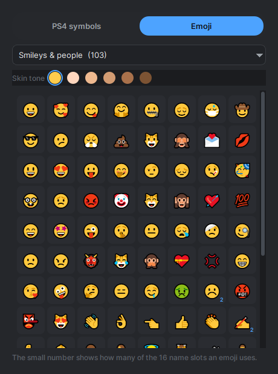

# PS4 Profile Studio

[](https://ko-fi.com/omarfx83)
[](https://github.com/omarfx83/ps4-profile-studio/releases)
[](LICENSE)
[](#download-windows)

A small Windows desktop app that turns **one image (PNG or JPG)** into a complete
PS4 profile avatar set, **sends it straight to the console over GoldHEN FTP**, and
**edits a profile's display name with a built-in picker of 149 PS4 symbols and
371 emoji**.

Output files:

| File | Size | Format |
|---|---|---|
| `avatar64.dds` | 64 × 64 | DDS, DXT5 (BC3), no mipmaps |
| `avatar128.dds` | 128 × 128 | DDS, DXT5 |
| `avatar260.dds` | 260 × 260 | DDS, DXT5 |
| `avatar440.dds` | 440 × 440 | DDS, DXT5 |
| `avatar440.png` | 440 × 440 | PNG (RGBA) |

What it does:

- crops, masks and exports the avatar set above from a single photo
- uploads the set to one user or to every user over GoldHEN's FTP
- edits a profile's display name with a built-in picker of 149 PS4 symbols and
  371 emoji
- remembers up to 10 consoles, each with an optional friendly name

> **Custom profile names need activation.** The console shows a user's custom
> name (the field this app edits) only once that profile is **activated** — for a
> never-activated local user it keeps its own local name. For offline activation,
> use **Apollo Save Tool → "Activate Offline Account"**, then the app's Profile
> tab name changes appear. **Avatar changes work on any profile.**

## Download (Windows)

Grab `PS4-Profile-Studio-<version>-win64.zip` from the
[releases page](https://github.com/omarfx83/ps4-profile-studio/releases),
extract it, and run `PS4 Profile Studio.exe`. **No Python and no installation
required** — Windows 10 or 11, 64-bit.

Windows may warn that the app is unsigned — click **More info → Run anyway**.

Everything lives in the extracted folder, so deleting it uninstalls the app.

## Screenshots

**Avatar tab — Editor** (mask menu, PS4-blue preview, transparency)

| | | |
|---|---|---|
|  |  |  |

**Avatar tab — Send**

| | |
|---|---|
|  | |

**Profile tab — display name, PS4 symbols and emoji**

| | |
|---|---|
|  |  |
|  | |

The sections below cover running from source and how the app works.

## Requirements (running from source)

- Windows with Python 3.10+
- Pillow: `pip install Pillow`
- Qt for Python: `pip install PySide6-Essentials`

## Run

**Double-click `PS4 Profile Studio.bat`.** It checks for Python and the
dependencies (installing them if needed) and starts the app with `pythonw`, so
no console window stays open.

Or from a terminal:

```bat
python profile_studio.py
```

Optionally open an image straight away:

```bat
python profile_studio.py --open "C:\path\to\photo.jpg"
```

## Workflow

1. **Open Image** — pick a `.png`, `.jpg` or `.jpeg`, or just **drag & drop** an
   image file onto the window. Non-square images are shown in full with
   everything outside the crop square dimmed.
2. **Crop**
   - Drag inside the square to move it.
   - Drag any of the 8 handles to resize. The selection is always square.
   - Drag on an empty area to draw a new square.
   - Mouse wheel zooms, **Fit** resets, middle-mouse drag pans.
   - A rule-of-thirds grid helps with framing.
   - The square can grow **past the image edges** (the outside area stays
     transparent), up to the picture's long edge. **Whole image** frames the
     entire photo in one click — useful when the subject doesn't fit a
     short-edge square.
3. **Apply Crop** — the right panel shows real previews for 440 / 260 / 128 / 64.
   Every preview is encoded to DXT5 and decoded back, so you see the actual
   compression result, not a clean resize.
4. **Re-crop** — go back to the crop screen with the same selection still in
   place, adjust, and apply again.
5. **Mask** — choose a shape for the avatar's alpha: *Square*, *Circle*,
   *Rounded*, *Squircle*, *Hexagon*, *Octagon*, *Star*, *Diamond* or *Heart*.
   *Circle* gives the PS4-style round avatar. The mask **outline is drawn over
   the crop square while you edit**, so you can see what the mask keeps before
   applying. Zoom with the controls under the canvas or the mouse wheel (**Fit**
   resets). Applies to previews and exported files.
6. **Padding %** — leave a transparent margin between the mask and the edges of
   the square output, so the avatar has breathing room (e.g. a smaller circle
   instead of one that fills the frame). It is a percentage, so it scales
   correctly across all output sizes. Set it to `0 %` for an edge-to-edge
   avatar. The mask outline follows the inset while you edit.
7. **PS4 blue preview** — on by default. Shows the avatar inset on a
   PS4-home-screen-style blue gradient, so you can judge how the PNG looks on
   the console's default theme. Turn it off for the checkerboard, which makes
   transparency easier to see.
8. **Export…** — choose any folder. Existing files prompt before overwrite.
   After exporting you can open the folder directly.

### Export options

- **Also write `avatar.png`** — some tools/firmware use this name.
- **Also write `picture*.dds` / `picture.png`** — needed for offline-activated
  accounts (duplicates of the avatar files under the `picture` names).
- **Copy `online.json` + `version.json`** — copies these two metadata files from
  a folder you select (usually a PS4 profile folder). This option copies
  them unchanged; it never generates them.

## Sending the avatar to the PS4

Open the **Avatar** tab and switch to its **Send** sub-tab (next to **Editor**).
The user list is on the left; the **Send avatar** panel on the right sends the
finished avatar set straight to the console.

### Before you connect

The app talks to **GoldHEN's built-in FTP server**, so the console must be
prepared first:

1. Start GoldHEN on the PS4 (it prints the console's IP address on screen).
2. Make sure its **FTP server** is enabled — the default port is **2121**.
3. Keep the PC and the PS4 on the same network.

You can also read the IP from the console itself:
**Settings → Network → View Connection Status → IP Address**.

If a connection fails, check in this order: GoldHEN is running, the FTP server
is enabled, the address has no typo, and the PC can reach the console's network.

### Connect (top bar)

The connection controls sit in the **top bar**, always visible:

| Field | Default | Notes |
|---|---|---|
| Device | last connected | pick a saved console, or type its IP |
| Port | `2121` | GoldHEN FTP server port |

GoldHEN's FTP server does **not** authenticate, so there is **no username or
password** to enter.

**Saved consoles.** Every console you connect to successfully is remembered —
up to **10**, most recent first. They appear in the **Device** list with their
address, and you can give each one a friendly name (for example
*Living Room*). Use the **⋯** button next to the list to:

- **Rename console…** — set a name, or clear it to show the address instead
- **Forget console** — remove the current one from the list
- **Forget all consoles** — clear the whole list

A fresh install starts with an empty list: no address is prefilled. Typing an
address by hand works exactly as before, and the console is added to the list
once the connection succeeds.

The app connects in passive mode and reads the profile folders in
`/system_data/priv/cache/profile/`. Every `0x…` folder is listed automatically
with:

- its current avatar thumbnail (read from `avatar440.png` or a DDS fallback)
- the display name from `online.json` (PS4 button glyphs are stripped)
- the folder ID and last-modified time

There is no fixed user limit — the list comes from the console itself.

### Send

1. Finish a crop in the **Editor** sub-tab (the panel shows the ready preview).
2. Pick a user in the **Users** list (single selection).
3. **Send avatar** — or **Send to all users** with confirmation.
4. The progress bar and status line show progress; **Cancel** stops after the
   current user.

**Backup before overwrite** is on by default. Before uploading, the app copies
the existing avatar files plus `online.json` and `version.json` to:

```
backups/<timestamp>/<0x…>/
```

If the backup cannot be written, that user is skipped instead of being
overwritten.

The app uploads `avatar64/128/260/440.dds` and `avatar440.png` (plus `picture*`
if that option is enabled). **`version.json` is never uploaded or changed.**
With **Refresh console after send** on (default), it also writes `online.json`
— re-writing the user's existing file unchanged, or creating a minimal one
(seeded from the console's local name) when the user has none. That prompts the
console to re-read the profile so the new avatar shows without signing out.

After a successful send the app **re-reads the console** so the user list (names
and thumbnails) reflects the change.

Connection settings and the saved console list live in
`profile_studio.local.json`, and backups in `backups/`. In the portable build
both live next to the executable; when running from source they live in the
project folder. If that folder is not writable, they fall back to
`%APPDATA%\PS4ProfileStudio\`. No credentials are stored.

## Profile tab (user name, symbols and emoji)

The **Profile** tab edits a user's **display name** (`online.json` →
`firstName`). This is the profile name, not your PSN online ID.

1. Connect in the **top bar**, then open **Profile**.
2. Pick a user from the list (single selection). The current name loads from
   `online.json` (`firstName`).
3. Edit the name. **Symbols…** opens the picker, with two tabs:
   - **PS4 symbols** — **149 symbols** in 7 categories, plus an **All** group.
   - **Emoji** — **371 emoji** in 8 categories (Smileys & people, Animals &
     nature, Food & drink, Travel & places, Activities, Objects, Symbols,
     Flags), plus an **All emoji** group. The swatches above the grid pick a
     **skin tone**, which applies to every emoji that has one.

   Clicking any tile inserts its character straight into the name field — no
   copy/paste.
4. **Apply name** asks for **confirmation**. The **Back up before saving**
   toggle (on by default) copies the whole profile folder first, then the app
   uploads **only** `online.json` and **reads it back** to confirm the console
   stored it. If the user has **no `online.json` yet** (a fresh/offline profile
   that was never activated), the app creates a minimal, console-shaped one
   with the entered name instead of failing.
5. The name is capped at **16 characters**, and the counter beside **PROFILE
   NAME** shows how many are used. The limit counts characters, not bytes, so
   an emoji such as 😀 uses one slot even though it is stored as four bytes.
   If the name is full the picker says so instead of quietly ignoring clicks.
   After a successful apply the app re-reads the console; if the name doesn't
   refresh on the PS4 itself, restart it (or sign out and back in).

**Reset** reverts the field to the last loaded name (not applied yet).

Only the name value is changed — every other field in `online.json`
(`onlineId`, `avatarUrl`, `lastName`, `trophySummary`) is preserved.

> The symbols are **private-use characters**: the app shows them as plain
> blocks and the PS4 renders them as icons. Only characters the console
> actually draws are listed — anything that would appear as a `?` box is
> filtered out, so every symbol in the picker is safe to use.

> Emoji are drawn as **live text**: the picker uses the system's own emoji font
> and inserts a standard Unicode character, so nothing is bundled and nothing
> depends on an image file. Two kinds of tile look different from the console
> for technical reasons:
>
> - **Flags** show a two-letter code (JP, US, GB). Windows has no flag artwork
>   in its emoji font, so a flag would print as those letters anyway; the
>   console draws the real flag.
> - **Multi-part emoji** (flags, skin tones, joined families) carry a small
>   number in the corner: how many of the 16 name slots they use. 👍🏽 uses 2
>   and 👨‍👩‍👧 uses 5.
>
> The list only includes emoji that your Windows emoji font can draw, so no
> tile shows a `?` box.

### Custom names need an activated profile

The app writes a user's **display name** (`online.json`). The console only shows
it for a profile that is **activated**; on a plain local profile it keeps its
own name. For offline activation, use **Apollo Save Tool → "Activate Offline
Account"**.

## Installing on the PS4 manually

1. Copy the exported files into the profile cache folder on the console:
   `/system_data/priv/cache/profile/0x<userid>/`
   (over FTP — GoldHEN uses port 2121).
2. Keep the existing `online.json` and `version.json` if you are not replacing
   them.
3. Restart the console (or sign out and back in) if the avatar doesn't appear.

The **Avatar → Send** view does all of this for you, including the backup.

## Keyboard shortcuts

| Key | Action |
|---|---|
| `Ctrl+O` | Open image |
| `Ctrl+E` | Export |
| `Enter` | Apply crop |
| `Esc` | Cancel edits (revert to previous crop + mask) |

## Notes

- The working copy of very large images is capped at 2000 px, which is far more
  than the 440 px output needs and keeps the editor responsive.
- EXIF orientation is applied automatically, so phone photos are not sideways.
- PNG transparency is preserved, and every mask is applied through an
  antialiased alpha channel.
- DXT5 is lossy. Sharp diagonal edges may show slight blockiness — this is
  exactly what the PS4 will display.
- The **Inter** typeface is bundled with the app, so no font installation is
  needed (SIL Open Font License, see `ps4_avatar_qt/assets/fonts/OFL.txt`).

## Portable by design

The app never installs anything. Settings (`profile_studio.local.json`, which
holds the console list) and `backups/` live next to the executable, so the whole
folder can be moved to another PC or a USB stick. If that folder is not writable,
the app falls back to `%APPDATA%\PS4ProfileStudio\`.

To uninstall, delete the folder.

## Command-line alternative

`make_avatar.py` does the same conversion without a GUI:

```bat
python make_avatar.py photo.jpg --out "D:\...\Avatar"
python make_avatar.py photo.jpg --circle
python make_avatar.py photo.jpg --mask Star
```

It shares the same DDS encoder and image helpers as the GUI.

## Project layout

```
profile_studio.py           launcher (keeps the .bat working)
make_avatar.py              command-line converter
ps4_avatar/                 shared core (no UI)
  dds.py                    DXT5 (BC3) encoder
  imaging.py                crop / mask / padding / background helpers
  models.py                 User and AvatarSet
  settings.py               local settings and backup paths
  ps4/ftp.py                GoldHEN FTP client
  ps4/sender.py             avatar backup and upload
  ps4/profile.py            read / write the user name (online.json)
ps4_avatar_qt/              Qt application (PySide6)
  app.py                    window, header (tabs + connection) and controller
  session.py                shared PS4 FTP connection
  theme.py                  colours, fonts, spacing, QSS
  symbols.py                the PS4 symbol set loader
  emoji.py                  the curated emoji set loader
  resources.py              bundled-asset paths (works in a packaged build)
  ui/connection_bar.py      top-bar connection controls
  ui/user_list.py           shared single-select user list / cards
  ui/editor_view.py         Avatar tab: crop editor
  ui/send_view.py           Avatar tab: send panel
  ui/profile_view.py        Profile tab: user list + name panel
  ui/symbols_panel.py       symbol + emoji picker (icons, glyphs, flag codes)
  ui/widgets.py             toggles, dropdown/menu cards, status dot, tabs
  assets/                   bundled Inter font, symbol icons, emoji data
```

The UI is built with Qt (PySide6): real anti-aliased widgets, a dark QSS
theme, and a bundled font, so no UI libraries beyond Qt and Pillow are needed.

Optionally install it as a command:

```bat
pip install .
ps4-profile-studio
```

## Building a release

Requires Python 3.10+ with Pillow and PySide6-Essentials installed.

```bat
.\build.ps1
```

The script creates a local `.venv`, installs PyInstaller into it, builds a
windowed `onedir` app, and produces:

```
release\PS4-Profile-Studio-<version>-win64.zip
release\PS4-Profile-Studio-<version>-win64.zip.sha256
release\RELEASE-NOTES-<version>.md
```

The ZIP contains a single `PS4 Profile Studio` folder with the executable,
the bundled runtime, `README.txt`, `LICENSE` and `THIRD-PARTY-NOTICES.txt`.
The release notes are generated from `packaging\RELEASE-NOTES.md`.
Override the version with `.\build.ps1 -Version 1.0.0`.

## License

Released under the **MIT License** — see [`LICENSE`](LICENSE).

Bundled components: the **Inter** typeface (SIL Open Font License, see
`ps4_avatar_qt/assets/fonts/OFL.txt`), plus Python, Qt/PySide6 and Pillow.
Their notices and full license texts are in
[`packaging/THIRD-PARTY-NOTICES.txt`](packaging/THIRD-PARTY-NOTICES.txt) and are
shipped in the `licenses/` folder of the release ZIP.

